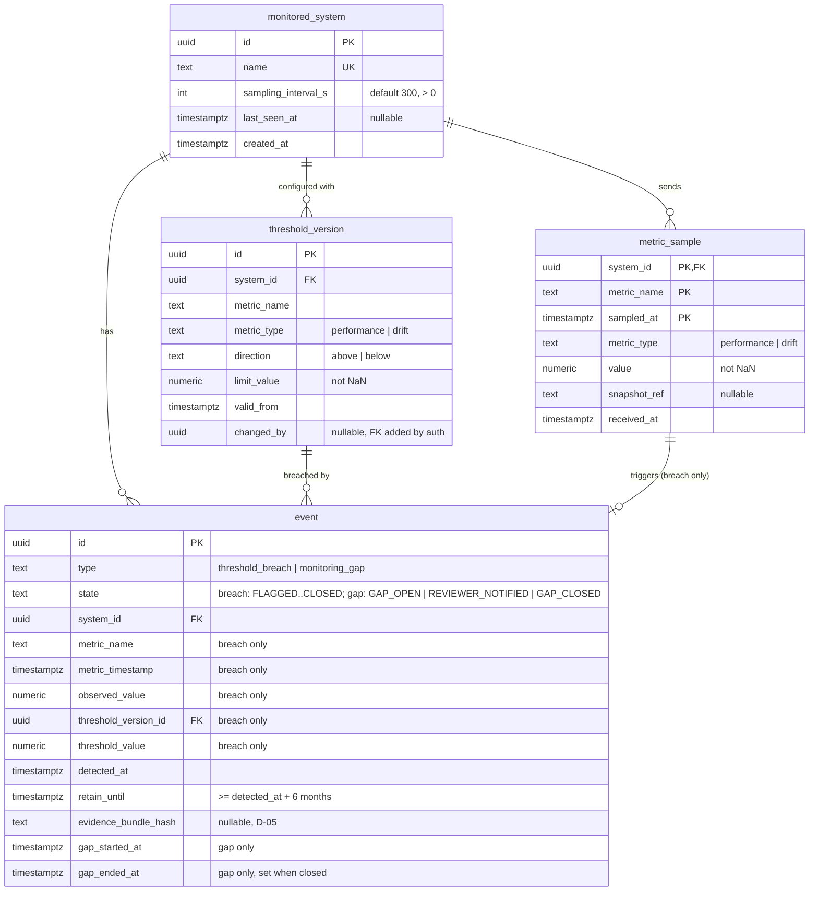

# Database schema

PostgreSQL schema for the monitoring service, based on **Model 2** of the Phase 2 specification
and the **Section 5.2** API schemas. Where this schema differs from Model 2, the reason is linked
to [spec-decisions.md](spec-decisions.md).

| Migration | Tables | Requirements |
|---|---|---|
| `0001` | (baseline, empty) | |
| `0002` | `monitored_system`, `metric_sample`, `threshold_version`, `event` | REQ-01, REQ-03, REQ-05 (storage only) |
| `0003` | `app_user`, `api_key`, `ledger_entry`, `webhook`, `notification`, `notification_delivery`, `simulated_clock`, `worker_heartbeat`; gap columns/states on `event`; `gap_missed_intervals` on `monitored_system` | REQ-02, REQ-04, REQ-06, REQ-13, REQ-14 |

## Diagram

## Conventions (apply to every table, including teammates')

- **Timestamps** are `timestamptz`, stored and compared in UTC. Code reads "now" only through
  `app.core.clock`, never `datetime.now()` or SQL `now()`, so the test clock works.
  (`monitored_system.created_at` uses `now()` as a server default because nothing time-sensitive
  depends on it.)
- **Metric values and limits** are `numeric` (Python `Decimal`), never float, so comparisons at the
  threshold are exact (AC-03). `'NaN'` is rejected by CHECK constraints.
- **Enumerations** are `text` with a `CHECK ... IN (...)` constraint (helper: `app.db.base.check_in`),
  not native PostgreSQL ENUMs, so the value sets can change with a one-line migration.
- **Foreign keys** use `ON DELETE RESTRICT`. Nothing cascades: records needed for retention and audit
  can't disappear as a side effect of another delete.
- **Constraint names** follow `app.db.base.NAMING_CONVENTION` (`pk_`, `fk_`, `uq_`, `ck_`, `ix_`).
- **IDs** are UUIDs generated by the application (`uuid4`).

## Tables

### `monitored_system` (module `systems`, shared)
One row per monitored high-risk AI system.
- `sampling_interval_s`: REQ-01 configurable sampling interval (default 300 s = 5 min).
- `last_seen_at`: updated by metric ingestion (REQ-01). The monitoring-gap sweeper (REQ-02) reads it.
- Not here yet: REQ-02 gap-timeout settings and REQ-13 API keys. Their owners add them in their own
  migrations (a separate `api_key` table referencing `monitored_system.id` is the expected shape).

### `metric_sample` (module `metrics`, REQ-01)
Raw performance and drift metrics, one row per measurement.
- **Primary key** `(system_id, metric_name, sampled_at)` makes ingestion idempotent (Model 2). What
  the API returns for a repeated submission is still open: D-04.
- `sampled_at` is the API's `timestamp`, the time of the measurement. `received_at` is the server
  time it arrived (an addition to Model 2, used for AC-01 and late-data detection).
- `metric_type` and the name `metric_name` match the API (D-02).
- Model 2 says samples are retained at least six months (REQ-05). See *Retention* below.

### `threshold_version` (module `thresholds`, REQ-03)
Versioned threshold configuration per `(system_id, metric_name)`.
- **Insert-only.** Changing a threshold means inserting a new row with a later `valid_from`; rows are
  never updated. `UNIQUE (system_id, metric_name, valid_from)`.
- **Threshold in force** for a sample: the row with the greatest `valid_from <= sampled_at`.
- `direction` (D-01): `above` breaches when `value > limit_value` (e.g. drift); `below` breaches
  when `value < limit_value` (e.g. accuracy, Model 5 Ex-1). Comparison is **strict**, so a value equal
  to the limit never breaches (AC-03). Implemented in `thresholds.models.Direction.breaches`.
- `changed_by` has no FK yet. Model 2 links it to the users table, which the auth module owns;
  the auth owner adds the constraint.

### `event` (module `events`, REQ-03 creation, REQ-05 storage), shared
Flagged threshold breaches and monitoring gaps. Type and state names follow the API (D-03).
- **Breach events** (written by `events`, Phase 3): always `state = 'FLAGGED'` on creation. The
  `ck_event_breach_fields_present` constraint guarantees every REQ-03 field is recorded: metric name,
  metric timestamp, observed value, threshold version and threshold value (a copy of the limit at
  flag time).
- **Triggering sample**: `fk_event_triggering_sample` links `(system_id, metric_name, metric_timestamp)`
  to `metric_sample`. The sample must exist and can't be deleted while the event exists.
- **One event per sample**: the unique constraint `uq_event_triggering_sample` prevents a duplicate
  submission from creating a second breach event (D-04). Gap events leave these columns NULL, and
  NULLs never conflict. The constraint's index also serves the RESTRICT check of
  `fk_event_triggering_sample` when a sample is deleted (the Phase 5 retention purge).
- `detected_at`: clock time when the event was flagged (REQ-15). Set once and never updated (INV-13).
- `retain_until`: see *Retention*.
- `evidence_bundle_hash`: sha256 hex of the evidence bundle. **Nullable and not computed yet**
  (D-05).
- Indexes support `GET /v1/events`: `(detected_at, id)` for the default newest-first ordering, plus
  `(system_id, detected_at)`, `state` and `type` for the filters.

### `app_user`, `api_key` (module `auth`, REQ-13)
- `app_user.id` is the `actor_id` written to the ledger. `role` is `system | viewer | reviewer |
  admin`; `ck_app_user_system_scope` makes system accounts name exactly one `system_id` and human
  accounts none. `threshold_version.changed_by` references it.
- `api_key` stores only `key_hash` (sha256 of a 256-bit random key, unique) and a short
  `key_prefix` to tell keys apart. Revoked keys keep their row (`revoked_at`).

### `ledger_entry` (module `ledger`, REQ-06, REQ-14)
- Append-only hash chain: `seq` (gapless, from 1), `prev_hash` = previous `entry_hash`
  (`uq_ledger_entry_prev_hash` forbids forks), `entry_hash` = sha256 of the canonical entry
  (D-14). `event_id` references `event` with RESTRICT, so an audited event can't be deleted.
- `actor_id` deliberately has no FK, so an export can be verified on its own.
- Tampering is detected, not prevented (Ex-5, AC-06): `GET /v1/ledger/verify` re-walks the chain.

### `webhook`, `notification`, `notification_delivery` (module `notifications`, REQ-04)
- `notification` is the outbox row written in the event's transaction; `deliver_by` = created +
  `NOTIFY_MAX_DELAY_S`. `dispatched_at` stays NULL until a subscribed webhook exists.
- `notification_delivery` is one row per (notification, webhook), with status, attempts, the
  next attempt time and the last error. Partial indexes serve the worker's two queries.

### Monitoring gaps (module `monitoring_gaps`, REQ-02) on `event`
- `monitored_system.gap_missed_intervals` (default 3) sets the timeout per system.
- Gap events have `type = 'monitoring_gap'`, their own states (D-12), `gap_started_at` (last data
  before the gap) and `gap_ended_at` (first data after it, set when closed). CHECKs pair states
  with types (INV-12) and require the gap fields. `uq_event_one_open_gap_per_system` allows one
  open gap per system. `ix_metric_sample_system_id_received_at` finds when data resumed.

### `simulated_clock`, `worker_heartbeat`
Single-row tables: the test environment's clock offset, shared by the API and the worker (D-16),
and the worker's liveness for `/healthz`.

## Retention (REQ-05): storage only

Phase 3 implements the **storage** part of REQ-05:
- `event.retain_until` is stored for every event. `app.modules.events.models.retain_until_for()`
  computes it as `detected_at` + 6 calendar months in UTC.
- `ck_event_retain_until_min_6_months` makes the database reject any event whose `retain_until` is
  less than six months after `detected_at` (INV-10). The month arithmetic is pinned to UTC so the
  check doesn't depend on the connection's time zone.
- `RESTRICT` foreign keys stop a monitored system, threshold version or triggering sample from being
  deleted while an event references it.

**Not implemented yet** (Phase 5, retention half of REQ-05; AC-05):
- Nothing currently *prevents* deleting an `event` row or a non-triggering `metric_sample` before
  `retain_until`, other than the foreign keys above.
- No job removes data after its retention period, and nothing protects the ±1 h evidence-window
  samples of an event (D-05).
- Backup retention (Lightsail keeps 7 days of point-in-time restore) is not part of this.

## Extending the schema

1. Create `app/modules/<module>/models.py` using `app.db.base.Base`, and follow the conventions above.
2. Import the module in `app/db/models.py` so Alembic sees it.
3. Add a migration (`alembic revision --autogenerate -m "..."` once a database is available) and
   review it by hand. Never edit a migration that has already been merged.
4. **Reference events with** `event_id uuid NOT NULL REFERENCES event(id) ON DELETE RESTRICT`.

Still to come (Model 2):

| Table / change | Phase | Links to |
|---|---|---|
| `record_key` (REQ-16 crypto-shredding) | 5 | `event.id` |
| `art349_field`, `disposition`, `escalation`, `report` | 4–5 | `event.id` |
| new `ledger_entry.entry_type` values (`FIELD_CONFIRMED`, `DISPOSITION`, ...) | 4 | alter `ck_ledger_entry_entry_type` |

Changing `event.state` or `event.type` values: alter the `ck_event_state` / `ck_event_type` CHECK
constraints in a migration, update `EventState` / `EventType`, and update D-03 in spec-decisions.md.
